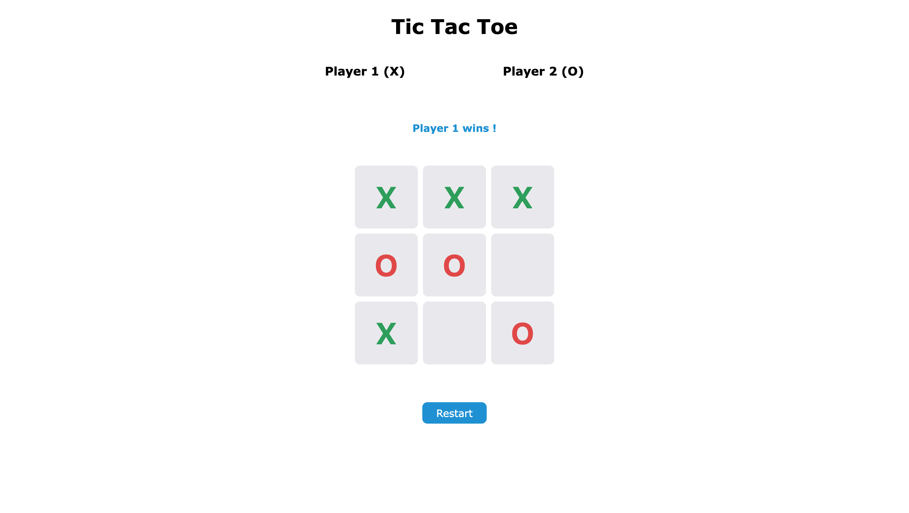

# Tic-Tac-Toe
A Tic Tac Toe game you can play in your browser, with game logic completely separated from the UI.

**[Online demo](https://ikab08.github.io/tic-tac-toe/)**

## Features

- Two-player game (X and O) on a 3×3 grid
- Detection of wins (rows, columns, diagonals) and ties
- Rejection of invalid moves (square already occupied, game over)
- X in green, O in red
- Restart button to play again

## Technologies

JavaScript (ES6+), HTML, CSS (Grid)

## Run locally
Clone the repository, then open `index.html` in your browser. 
No dependencies to install.